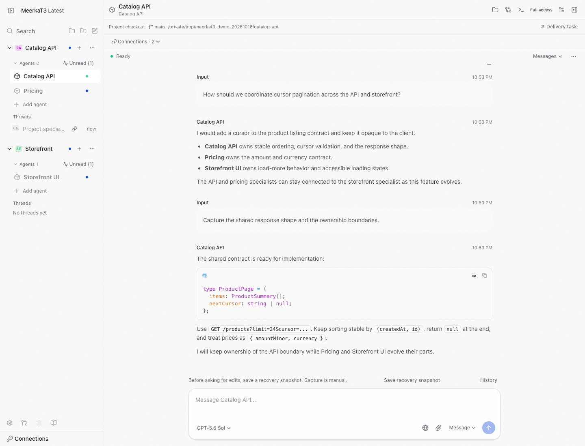
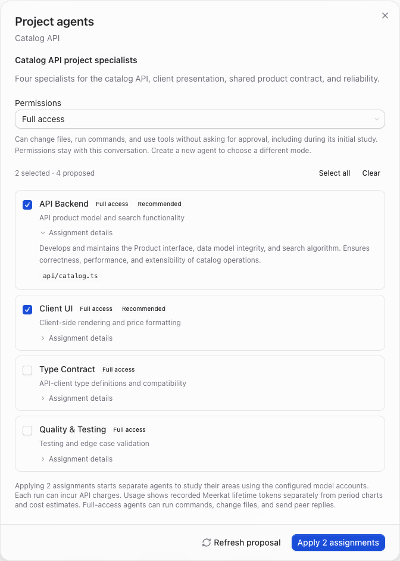
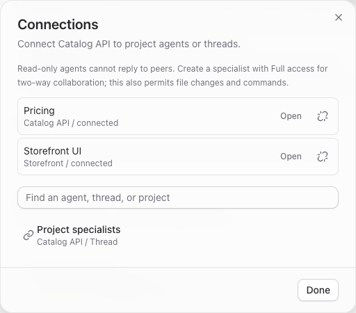

# MeerkaT3

**A [T3 Code](https://github.com/pingdotgg/t3code) fork powered by [Meerkat](https://github.com/lukacf/meerkat), built around long-lived project specialists and connected agents.**

Study a repository, prepare specialists for its domains, and keep working with those agents as the project evolves. A catalog specialist can coordinate an API change with a storefront specialist, with each working in its own checkout.



_Actual MeerkaT3 interface with sample projects and [demonstration content](docs/images/README.md). The screenshots below use the same sample data._

**Source preview:** Apple Silicon Macs, macOS 13 or later. The current source uses Meerkat Core and Meta 0.9.1. A public desktop installer has not yet been published.

[Build from source](docs/operations/development.md) · [First project](docs/user/getting-started.md) · [User guide](docs/README.md) · [Report an issue](https://github.com/lukacf/meerkat-t3/issues)

## What changes from T3 Code?

T3 supplies the workbench: conversations, files, terminal, Git worktrees, change review, and pull requests.

| Area                    | Original T3 Code                                                                                                                                                  | MeerkaT3                                                                                                                                            |
| ----------------------- | ----------------------------------------------------------------------------------------------------------------------------------------------------------------- | --------------------------------------------------------------------------------------------------------------------------------------------------- |
| **Agent runtime**       | Integrates multiple coding-agent harnesses, including Codex and Claude Code.                                                                                      | Uses one bundled Meerkat Core + Meta runtime for agent execution, state, and message delivery.                                                      |
| **Project workflow**    | Organizes work into projects and task threads, with delegated subagents.                                                                                          | Adds long-lived specialists generated from the repository's domains, alongside task coordinators and temporary workers.                             |
| **Collaboration**       | External agents can [operate threads through MCP](https://github.com/pingdotgg/t3code/blob/3b99fb2d2114f57c96bf92e4ed1c7ce5eaa67b1e/docs/user/outside-agents.md). | Explicit peer connections let specialists and coordinators communicate within and across project checkouts on the same computer.                    |
| **Accounts and models** | Authentication and model choices depend on the selected agent integration.                                                                                        | In-app account setup uses Meerkat's native authentication and model catalog, including recommended and supported models available to your accounts. |

MeerkaT3 is maintained independently from the original T3 project.

## Specialists that stay with your project

Repository study proposes specialists for your code's domains. Review their assignments and choose which to prepare.



- **Project specialists** retain their instructions and conversations across tasks. Return to the same domain expert as the repository changes.
- **Task threads** bring a coordinator and selected specialists together for a particular change.
- **Workers** handle temporary pieces of a task, alongside the long-lived specialists.

Open specialists from the sidebar to assign work, steer a turn, or inspect results. See the [agent guide](docs/user/agents.md).

## Connect agents across repositories

Drag an agent onto another agent, or use **Connections**, to establish a peer relationship. A backend specialist can coordinate with a client specialist in another project; a task coordinator can bring the relevant specialists into a change.



Each agent retains its own conversation and checkout. Connections enable communication without merging histories. [Permissions](docs/user/permission-modes.md) govern peer messaging.

## Get started

Follow [Build from source](docs/operations/development.md) for the pinned Node, pnpm, Rust, and Xcode prerequisites, then:

```sh
git clone https://github.com/lukacf/meerkat-t3.git
cd meerkat-t3
pnpm install --frozen-lockfile
pnpm native:build
pnpm dev:desktop
```

Once the app opens:

1. **Connect a model account** in Settings > Providers. Sign in or add an API key using the methods offered for that account.
2. **Open a project and study its repository.** Review the proposed domain specialists and prepare the ones you need.
3. **Connect relevant peers** within the project or across related repositories.
4. **Give a specialist an objective.** Inspect changes, run your project's checks, and commit the work you want to keep.

The runtime is included; a separate coding-agent CLI is not needed. Model access depends on your accounts, and model credits are not included. Hosted model requests send context to the selected provider. See [Accounts](docs/user/accounts.md) and [Data and privacy](docs/user/telemetry.md).

Windows, Linux, mobile, remote installation, and the original T3 hosted services are outside this preview. Preview packages use ad-hoc signing and manual updates. Future installers and checksums will appear on [Releases](https://github.com/lukacf/meerkat-t3/releases).

## Documentation and contributing

Browse the [documentation index](docs/README.md), or read user guides offline through **Help > MeerkaT3 Guide**.

- [Contributing](CONTRIBUTING.md) - setup, focused checks, and change proposals.
- [Architecture](docs/internals/overview.md) - the T3 workspace and Meerkat runtime boundary.
- [Troubleshooting](docs/user/troubleshooting.md) - recovery and useful bug reports.
- [Issues](https://github.com/lukacf/meerkat-t3/issues) - MeerkaT3 bugs and proposals.
- [Security](SECURITY.md) - private vulnerability reporting.
- [Code of conduct](CODE_OF_CONDUCT.md) - community expectations.

## Credits and license

MeerkaT3 builds on [T3 Code](https://github.com/pingdotgg/t3code) and preserves its [MIT license and attribution](LICENSE). [Meerkat Core](https://github.com/lukacf/meerkat) and Meerkat Meta, formerly MobKit, provide the agent runtime and coordination layer. Bundled dependencies retain their own licenses and [third-party notices](docs/user/open-source-licenses.md).
